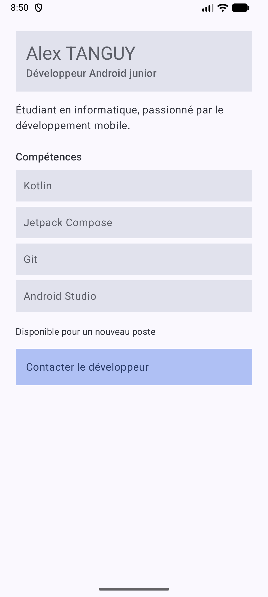

# DeveloperProfile - Jetpack Compose

## Présentation

Application Android développée en Kotlin avec Jetpack Compose.
Elle affiche une fiche de profil développeur avec un nom,
un rôle professionnel, une description, des compétences
et une disponibilité.

Une zone cliquable permet de représenter une action de contact.

## Notions utilisées

- Fonctions @Composable
- Paramètres et composants réutilisables
- Modifier et chaînage de modifiers
- Padding externe et interne
- Column, Text et Surface
- Callback onClick
- Accessibilité : Role.Button et contentDescription
- Previews

## Réponses aux questions

### 1. Quels composables avez-vous créés ?

J'ai créé ProfileScreen, ProfileHeader, SkillItem,
ContactInfo et ProfileAction.

### 2. Quel composable représente l'écran principal ?

ProfileScreen représente l'écran principal.
Il regroupe les différents éléments du profil.

### 3. Où utilisez-vous un padding externe ?

Dans ProfileScreen, le padding de 24.dp permet
d'espacer le contenu par rapport aux bords de l'écran.

### 4. Où utilisez-vous un padding interne ?

Dans ProfileHeader, le padding de 16.dp permet
d'espacer les textes à l'intérieur du composant Surface.

### 5. Quel composant reçoit un callback ?

ProfileAction reçoit un callback onClick.
Ce callback est appelé lors du clic sur la zone de contact.

### 6. Quelle information d'accessibilité avez-vous ajoutée ?

J'ai utilisé Role.Button pour identifier la zone cliquable
comme un bouton et contentDescription pour décrire son action.

### 7. Pourquoi vos composants sont-ils réutilisables ?

Les composables reçoivent des paramètres comme le nom,
le rôle ou les compétences. Ils peuvent donc afficher
plusieurs profils sans modifier leur structure.

## Previews

Deux previews sont disponibles :
- Alex TANGUY : développeur Android junior.
- Camille Durand : développeuse Android confirmée.

## Capture d'écran

